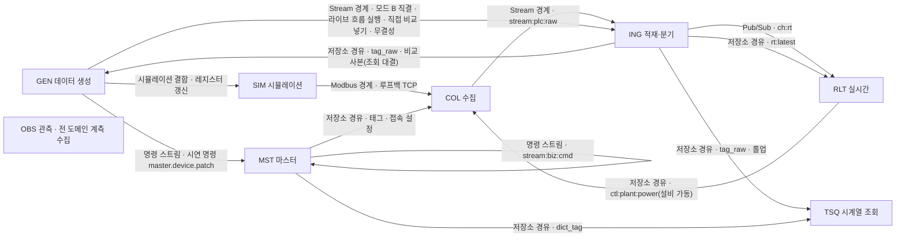

# 도메인 지도

> **대상**: 전 설계자 · 신규 합류자 — 8도메인이 어느 NestJS 모듈 · 평면 · 위치에 앉고, 서로 어떤 경계로 이어지며, 각 폴더에서 어디가 비는가
> **작성일**: 2026-09-24
> **개정일**: 2026-10-11 — **D-16 웹 7화면 · 새 기능 4 · 새 저장 객체**(사용자 결정 2026-10-11 · 기능 정본 02_features — GEN-13 · 14 · RLT-10 · 11 · 저장 정본 05_data_stores — run_result GEN 소유 · ctl:plant:power · cache:dual:active) — 8도메인 표 GEN · RLT 핵심 책임 · 평면 어긋남 표 GEN 표면 #2~#5 → **#2~#8** · RLT 행 설비 가동 키 · 의존 그래프 **간선 2 신설**(ING → GEN 저장소 경유 — 조회 대결이 원본 · 비교 사본을 읽는다 · RLT → COL 저장소 경유 — 설비 가동 키) · GEN → ING 라벨에 직접 비교 · 간선 11 → **13**(저장소 경유 4 → **6**) · 도메인 × 저장 객체 GEN(run_result · cache:dual:active) · RLT(ctl:plant:power) · 검산 PostgreSQL 8 → **9** · 소유 테이블 없는 도메인 6 → **5** · 도메인별 문서 좌표 화면 열 7화면 · 공백 매트릭스 05 GEN 공백 → **행** · 08 TSQ 공백 → **행** · 행 12 → **14** · 공백(선언) 15 → **13**
> **개정일**: 2026-10-11 — **D-16 알람 · 로그인 · 권한 · 감사 · 작업지시 · 측정 도구 삭제**(사용자 결정 2026-10-11 · 리드 판정 — WRK 함께 폐지) — **도메인 11 → 8**(AUT · ALM · WRK 폐지 — 평면 제어 6 → **3**) · §11도메인 → **§8도메인** · GEN APP_ROLE datagen → **api(라이브 실행) · collector(모드 A)** · 주입 모드 A~D · 백필 · 부하 주입 표면 → **A · B · 라이브 실행** · APP_ROLE 값 5 → **4** · 도입 단락 직접 호출 예외 → **없음** · 평면 어긋남 4 → **3**(ALM 삭제 · GEN 표면 bulk → 라이브 실행) · 의존 그래프 간선 22 → **11**(인가 6 · 직접 호출 1 · 트랜잭션 공유 1 · ALM · WRK 자기 간선 2 · ALM → RLT 1 삭제) · 경계 유형 9 → **6** · 모드 D · 트랜잭션 공유 · W2 인가 불릿 교체 · 도메인 × 저장 객체 AUT · ALM · WRK 행 삭제 — PostgreSQL 16 → **8**(biz_command_log는 도메인 밖 명령 기전 소유) · ClickHouse 테이블 8 → **4**(업무 대조 3 · alarm_eval 삭제) · 소유 테이블 없는 도메인 6 불변(11 − 5 → 8 − 2) · 문서 좌표 AUT · ALM · WRK 행 삭제 · 공백 매트릭스 132 → **96**칸(12폴더 × 8도메인 — 파일 31 → **21** · 행 19 → **12** · 횡단 65 → **48** · 공백(선언) 17 → **15**) · 12_security AUT 파일 칸 삭제 · 삭제 문서 링크 정리
> **개정일**: 2026-10-03 — D-15 학습자 눈높이 한 화면(사용자 지시 2026-10-03 — 08_screen/08_evidence_screens) — OBS 행 화면 칸 측정 조건 서랍 → **각주 툴팁** — 도메인 · 대응 수 불변
> **개정일**: 2026-10-03 — 리드 판정(웨이브 1 정합 · 정본 08_screen/02_traceability) — 도메인 좌표 표 AUT · RLT 행의 08_screen 칸(로그아웃 · 무효화 신호 중계 → 화면 없음(API 전용)) · 08_screen 세는 기준 문장의 RLT · OBS 주 화면 EXP-FLOW · 공통 셸 → **EXP-FLOW** — 공백 매트릭스 불변(AUT · RLT · OBS는 다른 기능이 주 화면을 가진다 · 08_screen 행 4 · 공백 7)
> **개정일**: 2026-10-03 — D-14 2화면 전환(사용자 결정 2026-10-03) — 폴더 × 도메인 08_screen 행 재판정(정본 08_screen/02_traceability) — MST · TSQ · ALM · WRK 행 → **공백(선언)**(폐지 화면 — 화면 없음(API 전용)) · GEN 공백(선언) → **행**(2026-09-28 GEN-11 · 12 주 화면 반영 누락 정정) · 08_screen 행 7 → **4** · 공백 4 → **7** · 검산 행 22 → **19** · 공백(선언) 14 → **17** · 합계 132 불변 · 도메인 좌표 표 화면 열 8칸(AUT · MST · GEN · TSQ · RLT · ALM · WRK · OBS)을 현행 자리 또는 화면 없음(API 전용)으로
> **개정일**: 2026-09-28 — 라이브 실행 검수 반영(리드 재판정 2026-09-28) — GEN → MST 간선 설명 이름 토글 짝 → **시연 전용 행 한정 마스터 명령**(prepare가 사이트 · 라인 · 설비 생성 명령 · publish가 시연 전용 설비 DEMO-FLOW-DEV에만 master.device.patch · 되돌림 없음 · 운영 행 불변 · MST-02 명시 예외) — 간선 수 불변
> **개정일**: 2026-09-28 — 리드 정정(통합 확인) — GEN → MST 간선 설명의 "순 변경 없는 본문" → **이름 토글 짝**(06_pipeline/10과 일치) — 간선 수 불변
> **개정일**: 2026-09-28 — 라이브 실행 제어 반영(사용자 요구 2026-09-28 · 리드 판정) — 명령 스트림 경계에 **GEN → MST 간선 1**(라이브 흐름 실행의 시연 명령 master.device.patch · BizWritePort 프로세스 안 호출 · 같은 명령 스트림) — 명령 스트림 3 → **4**(자기 간선 3 + 도메인 사이 1) · 간선 21 → **22** · Stream 경계 GEN → ING 라벨에 라이브 흐름 실행
> **개정일**: 2026-09-27 — D-04 부분 개정 반영(사용자 결정 — 업무 쓰기도 Redis를 거친다 · ADR-26) — 경계 유형 **명령 스트림 경계** 신설(자기 간선 MST · ALM · WRK 3) · 간선 18 → **21** · WRK 소유에 biz_command_log · PostgreSQL 15 → **16**
> **개정일**: 2026-09-26 — W1 검수 반영 — 도메인 × 저장 객체 검산 ClickHouse 테이블 5 → **8**(목적지 5 + 소유 도메인 없는 계측물 3) · 표 밖 계측물 불릿 신설
> **개정일**: 2026-09-24 — 최종 정밀 검수 — 공백 매트릭스를 폴더 README 현행 선언에 맞춤: 공백(미선언) 5 → **0**(05_data_stores COL · TSQ · RLT · OBS · 06_pipeline OBS 선언 완료) · 08_screen GEN 행 → **공백(선언)**(W5 GEN 화면 없음) · 행 23 → **22** · 공백(선언) 8 → **14** · 롤업 객체 ING 귀속 확정(W3)
> **개정일**: 2026-09-24 — W3 판정 반영 — SIM · OBS APP_ROLE 배정(ADR-22) · GEN · ALM 역할 분할 서술
> **개정일**: 2026-09-24 — W2 판정 반영 — 인가 간선 AUT → GEN 추가(부하 주입 표면은 환경변수 게이트 + 인증) · 인가 5 → **6** · 간선 17 → **18** · GEN · OBS 인가 미정 불릿을 판정 결과로 교체
> **원천**: 원본 architecture.md §4 · §5 · §6 · §8.2 · §11(커밋 ff66a37) · 원본 tech_stack.md §3.1 · §3.3 · §10.1 · §11(커밋 ff66a37) · 원본 data_flow.md §1 · §2 · §7 · §7.2 · §8 · §11(커밋 ff66a37) · 원본 implementation_plan.md §6 · §7.3(커밋 ff66a37) · 저장소 루트 docs_plan.md(도메인 벡터 · 보정 #11 · #12 · #13) · D-16(사용자 결정 2026-10-11) · [../README.md](../README.md) 고정 기준(도메인 · 도메인 공백)

이 문서는 **도메인 ↔ NestJS 모듈 ↔ 평면 매핑의 정본**이다. 도메인은 NestJS 모듈과 1:1이 원칙이고(기록된 예외 둘 — §8도메인 검산), **도메인 경계가 곧 문서 소유권 경계**다 — 기능 ID는 [../02_features](../02_features/README.md)의 도메인 파일에서, 요구사항 ID는 [../03_requirements](../03_requirements/README.md)의 도메인 파일에서만 채번한다.

모든 도메인은 **api 컨테이너 하나의 NestJS 단일 프로세스 안**에 모듈로 산다(원본 architecture.md §4). 컨테이너가 하나라도 모듈 사이의 경계는 호출 스택이 아니라 Redis Stream · Pub/Sub · Modbus 소켓이며, 이 경계가 APP_ROLE로 모듈을 떼어낼 때 코드 변경을 없앤다. 의도된 예외였던 알람 판정의 직접 호출은 알람과 함께 D-16으로 지워져 **지금 도메인 사이에 직접 호출은 없다**([../04_architecture/02_module_boundaries.md](../04_architecture/02_module_boundaries.md)).

## 8도메인

| # | 접두 | 도메인 | NestJS 모듈 | 평면 | 컨테이너 내 위치 | APP_ROLE 분리 시 | 핵심 책임 |
|------|------|------|------|------|------|------|------|
| 1 | MST | 마스터 데이터 | master | 제어 | api 컨테이너 · apps/api/src/modules/master | api | 사이트 · 라인 · 설비 · Modbus 접속 설정 · 태그 마스터 · 캐시 무효화 체인 |
| 2 | COL | 수집 | collector | 데이터 | 상동 · modules/collector | collector | Modbus 폴링 · 디코딩 · 품질 판정 · 데드밴드 · Stream 발행 · 스풀 |
| 3 | SIM | 시뮬레이션 | plc-sim | 데이터 | 상동 · modules/plc-sim · 루프백 포트 대역 | **collector**(COL · GEN 모드 A와 동거 필수 — ADR-22) | Modbus TCP 서버 응답 · 레지스터 Buffer · 지연 · 오류 주입 |
| 4 | GEN | 데이터 생성 | datagen · runs | 데이터 | 상동 · modules/datagen · modules/runs | **api**(라이브 실행 · 직접 비교 · 센서 데이터 현황 · 지우기) · **collector**(모드 A) | 신호 프로파일 생성 · 주입 모드 A · B · 라이브 실행(흐름 시연 · 직접 비교 — D-16) · 센서 데이터 현황 · 지우기(D-16) |
| 5 | ING | 적재·분기 | ingest | 데이터 | 상동 · modules/ingest · 컨슈머 N개 | worker | Stream 소비 · 배치 적재 · 멱등 · 재시도 · DLQ · 최신값 갱신 · 분기 실행 · 대조군 동시 적재 |
| 6 | TSQ | 시계열 조회 | timeseries | 제어 | 상동 · modules/timeseries | api | 시계열 조회 · 해상도 자동 선택 · 캐시 · 스탬피드 방지 · 다운샘플 · 내보내기 |
| 7 | RLT | 실시간 | realtime · plant | 제어 | 상동 · modules/realtime · modules/plant | api(표면) · 설비 가동 적용은 collector 역할에서 돈다 | 최신값 조회 · WebSocket 게이트웨이 · 스로틀 병합 · 설비 가동 스위치 · HMI 설비 개요(D-16) |
| 8 | OBS | 관측 | metrics | 관측 | 상동 · modules/metrics | **전 역할**(저장소 통계 수집은 api 역할에서만 — ADR-22) | /metrics 통합 노출 · 저장소 메트릭 수집 · 헬스체크 |

### 검산

- 평면별: 제어 3(MST · TSQ · RLT) + 데이터 4(COL · SIM · GEN · ING) + 관측 1(OBS) = **8** · 옛 AUT(인증·인가) · ALM(알람) · WRK(업무 데이터)는 D-16 폐지 — 접두는 결번으로 남는다([../11_glossary/04_id_conventions.md](../11_glossary/04_id_conventions.md))
- APP_ROLE 값은 all(기본) · api · worker · collector다 — 옛 datagen 역할은 D-16 삭제. 도메인 → 역할 배정의 정본은 [../04_architecture/02_module_boundaries.md](../04_architecture/02_module_boundaries.md)(ADR-22)이며, 원본이 배정하지 않았던 SIM은 collector(루프백 바인드 · 레지스터 Buffer를 프로세스 안에서 갱신하므로 COL · GEN 모드 A와 한 컨테이너), OBS는 전 역할(저장소 통계는 api 역할에서만)로 W3이 판정했다. GEN은 기능별(모드 A collector · 라이브 실행 api)로 갈린다.
- **웹(Next.js)은 도메인이 아니다.** 호스트 프로세스이며 모듈이 아니라 표면의 소비자다. BFF 경로는 [../07_api/01_conventions.md](../07_api/01_conventions.md)가 소유한다.
- **모듈 1:1의 기록된 예외는 둘이다** — GEN은 datagen(생성기 · 모드 A)과 runs(라이브 실행 틀 — 흐름 시연 · 직접 비교 · 센서 데이터 현황 · 지우기)의 두 모듈이고, RLT는 realtime(최신값 · WebSocket)과 plant(설비 가동 · HMI 개요 — D-16)의 두 모듈이다. 기능 ID는 여전히 도메인 파일 하나에서만 채번하므로(GEN-12~14 · RLT-10 · 11) 채번 자리는 깨지지 않는다 — 모듈 수(apps/api/src/modules 11) = 도메인 8 + 둘째 모듈 2(runs · plant) + 도메인 밖 1(biz) = **11**.
- **업무 명령 기전(biz 모듈)도 도메인이 아니다.** 여러 도메인의 쓰기가 지나는 공통 경로이고 원장 biz_command_log를 소유한다([../05_data_stores/01_postgresql_schema.md](../05_data_stores/01_postgresql_schema.md)).

## 평면 분류와 실행 위치가 어긋나는 도메인

평면은 **코드가 어느 관심사에 속하는가**(원본 tech_stack.md §3.1 · §11 모듈 트리)로 가른다. 실행 위치(어느 호출 경로에서 도는가)와 늘 같지는 않다. 아래는 독자가 분류 오류로 신고하기 쉬운 세 경우다.

| 도메인 | 평면 | 실제로 도는 자리 | 어긋남이 맞는 이유 | 어긋남이 만드는 규칙 |
|------|------|------|------|------|
| GEN | 데이터 | 정상 수집 경로에 **참여하지 않는다** | 데이터를 만들어 경로 입구에 넣을 뿐 경로의 단계가 아니다 | 데이터 평면이지만 API 표면(09_datagen #2~#8 — 라이브 실행 · 부분별 최근 · 센서 데이터 현황 · 지우기)을 소유한다 — 옛 표면 /api/v1/ingest/bulk(docs_plan 보정 #11)는 D-16 삭제 |
| RLT | 제어 | 자기 테이블 없이 ING가 쓴 rt:latest · ch:rt를 읽고 · Redis 키는 설비 가동 ctl:plant:power 하나만 쓴다(D-16) | 표면(최신값 API · WebSocket · 설비 가동 · HMI 개요)이 제어 평면이다 | RLT의 신선도는 ING의 갱신 주기에 묶인다 — ClickHouse 중단이 최신값 정지로 번지는 결합(원본 implementation_plan.md §7.2) · HMI 개요도 같은 rt:latest를 읽어 같은 결합을 갖는다([../04_architecture/10_plant_adoption.md](../04_architecture/10_plant_adoption.md) §Redis 버퍼가 흡수하는 것과 못 하는 것) |
| OBS | 관측 | 전 도메인의 카운터와 세 저장소의 통계를 15초 주기로 모은다 | 측정 대상과 측정 도구를 가르는 별도 평면이다 | 의존 그래프 밖에 둔다 — 모든 도메인이 계측을 노출할 책임을 지고 OBS는 모으기만 한다 |

## 도메인 간 의존 그래프

도메인 사이의 연결을 경계 유형별로 그린다. 모든 간선이 데이터가 흐르는 경계다 — 점선이던 인가 · 트랜잭션 공유는 D-16으로 지웠다.

- **수집 → 적재의 경계는 반드시 Stream이다.** COL과 GEN 모드 B(라이브 흐름 실행)가 ING로 가는 길은 모두 stream:plc:raw를 지난다. 같은 프로세스 안이어도 예외가 아니며, 우회는 실험 전용 SW-01 off뿐이다(전역 불변식 "비동기 경계").
- **GEN → SIM은 Stream 경계 규칙의 대상이 아니다.** 레지스터 Buffer 갱신은 수집 **이전**의 모사 구간이고, 진짜 경계인 Modbus 소켓(SIM → COL)이 뒤에 온다. 같은 프로세스라는 이유로 Modbus 구간을 생략하지 않는다 — 생략하면 모드 A의 E2E 지연에서 Modbus 계층이 빠진다.
- **tag_raw에 닿는 길은 전부 ING를 지난다.** ING를 우회해 ClickHouse에 직접 쓰던 옛 GEN 모드 D(백필)는 D-16으로 지웠다 — 그 행이 멱등 토큰 · 대조군 동시 적재를 타지 않던 예외도 함께 사라졌다.
- **옛 MST → WRK 트랜잭션 공유(감사 로그)는 감사 기록과 함께 D-16으로 지웠다.** 업무 명령 원장 biz_command_log는 명령 기전(도메인 밖 biz 모듈)이 소유하고 명령 적용과 같은 트랜잭션에서 쓴다([../06_pipeline/07_business_crud.md](../06_pipeline/07_business_crud.md)).
- **설비 가동은 호출이 아니라 키로 건넌다(D-16).** RLT의 설비 가동 표면(api 역할)은 Redis ctl:plant:power만 쓰고, 수집기 역할의 설비 가동 적용이 1초마다 그 키를 읽어 폴링 · 가상 PLC 포트 · 모드 A 틱을 켜고 끈다 — 역할을 나눠도 표면 프로세스가 수집기 프로세스를 직접 부르지 않는다(기전 정본 [../02_features/08_realtime.md](../02_features/08_realtime.md) RLT-10). 켜고 끄는 대상(COL · SIM · GEN 모드 A)은 같은 collector 역할 안의 서비스다.
- **센서 데이터 지우기(GEN-14)는 다른 도메인이 소유한 저장 객체를 비운다** — ING 소유 tag_raw · 롤업 · 비교 사본과 Redis 대기줄 · 지금 값. 데이터가 흐르는 간선이 아니라 수명 조작이라 그래프에 간선을 두지 않고, 소유와 쓰기가 갈린 객체로 저장 정본에 등재한다([../05_data_stores/02_postgresql_constraints.md](../05_data_stores/02_postgresql_constraints.md) · [../05_data_stores/05_redis_keyspace.md](../05_data_stores/05_redis_keyspace.md)).
- **OBS는 그래프 밖이다.** 모든 도메인이 메트릭을 노출하고 OBS가 모은다. 계측 없는 스위치는 장식이므로 새 모듈은 메트릭과 함께 들어온다(전역 불변식 "계측 우선").

## 경계 유형

그래프의 간선을 경계 유형으로 센다. 유형은 닫힌 어휘다 — 새 간선이 어느 유형에도 들지 않으면 유형을 늘리기 전에 분류 축을 다시 본다.

| 경계 유형 | 매체 | 간선 | 경계가 보장하는 것 | 경계를 없애면 |
|------|------|------|------|------|
| Stream 경계 | Redis Stream + 컨슈머 그룹 | COL → ING · GEN → ING | 백프레셔 흡수 · at-least-once · 이벤트 루프 격리 · 역할 분리 시 코드 불변 | ClickHouse 삽입 지연이 Modbus 폴링 주기로 역류하고, 재시작 시 미처리 배치가 사라진다 |
| Pub/Sub 경계 | Redis Pub/Sub | ING → RLT | 발행자와 WebSocket 게이트웨이의 분리 · 수평 확장 시 코드 불변 | api 다중 인스턴스에서 팬아웃 코드를 새로 써야 한다 |
| Modbus 경계 | 루프백 TCP 소켓 | SIM → COL | 요청 인코딩 · 블록 병합 · 디코딩을 포함한 실제 수집 경로 | 모드 A E2E 지연에서 Modbus 계층이 빠진다 |
| 명령 스트림 경계 | Redis Stream stream:biz:cmd + 컨슈머 그룹 grp:biz-writer(소비자 1) · 결과 biz:result · ch:bizreply | MST → MST(같은 도메인의 쓰기 표면 → 명령 적용 워커) · GEN → MST(라이브 흐름 실행의 시연 명령 — 시연 전용 행 한정 master.site.create · master.line.create · master.device.create · master.device.patch — BizWritePort 프로세스 안 호출 · 같은 명령 스트림 · 같은 워커) | 업무 쓰기의 동기 응답(커밋 뒤) · 명령 ID 멱등 · 도착 순서 적용 · 수집 스트림과 키 · 그룹 분리(ADR-26 · D-04 개정) | 표면이 트랜잭션을 직접 커밋하는 옛 경로(SW-12 direct)로 돌아가 명령 멱등이 사라지고, 역할 분리 때 쓰기 적용 주체를 옮길 경계가 없다 |
| 저장소 경유 | 한 도메인이 쓰고 다른 도메인이 읽는 저장 객체 | ING → RLT(rt:latest) · ING → TSQ · MST → COL · MST → TSQ · ING → GEN(조회 대결의 원본 · 비교 사본 읽기 — D-16) · RLT → COL(ctl:plant:power — D-16) | 쓰는 쪽과 읽는 쪽의 수명 분리 | 호출 결합으로 바뀌어 한쪽 장애가 다른 쪽 응답으로 번진다 |
| 시뮬레이션 결합 | 프로세스 내 Buffer 갱신 | GEN → SIM | 모드 A의 현실 재현 | 해당 없음 — 수집 이전 구간이라 경계 규칙 밖이다 |

- 검산: Stream 2 + 명령 스트림 2(자기 간선 1 + 도메인 사이 1) + Pub/Sub 1 + Modbus 1 + 저장소 경유 6 + 시뮬레이션 결합 1 = **13**(그래프 간선 수와 같다) · 옛 유형 셋(직접 호출 예외 ING → ALM · 트랜잭션 공유 MST → WRK · 인가 AUT → 6)과 ALM · WRK 자기 간선 · ALM → RLT는 대상 도메인과 함께 D-16 삭제
- **명령 스트림 경계는 기본이 도메인 사이가 아니라 한 도메인 안의 두 역할 사이다(자기 간선).** 쓰기 표면(api 역할)이 명령을 싣고 같은 도메인의 쓰기 서비스가 워커 역할에서 적용한다 — 그래프에 자기 간선으로 그려 경계가 있다는 사실을 센다. Stream 경계와 유형을 가른 이유는 보장이 다르기 때문이다 — Stream 경계는 비동기 at-least-once이고 명령 스트림 경계는 응답이 적용 결과를 기다린다.
- **GEN → MST는 명령 스트림 경계의 유일한 도메인 사이 간선이다.** 라이브 흐름 실행(RunControlModule · api 역할)이 HTTP 표면을 거치지 않고 BizWritePort를 프로세스 안에서 불러 MST의 kind master.device.patch를 싣는다(prepare는 시연 전용 행이 없으면 사이트 · 라인 · 설비 생성 명령도) — 적용은 MST 쓰기 서비스가 워커에서 하므로 MST 소유 경로 그대로다(**시연 전용 설비 DEMO-FLOW-DEV에만** · 새 이름 · 되돌림 없음 · 운영 행 불변 · actor null · 정본 [../06_pipeline/10_datagen_inject.md](../06_pipeline/10_datagen_inject.md) §흐름 시연 실행 — flow). 인가가 없어(D-16) 실행 시작 표면을 부르는 누구든 이 명령을 일으킨다 — 잔여는 [../12_security/04_threat_model.md](../12_security/04_threat_model.md) §잔여 위험 등재(시연 전용 행).
- **인가 간선 유형이 없다(D-16).** 모든 표면이 무인증이다 — /api/v1/health · /metrics는 그 전부터 공개였고(REQ-OBS-10), 나머지는 로그인 · 권한 삭제로 공개가 되었다.

## 도메인 × 저장 객체

각 도메인이 **소유**(스키마를 정의하고 쓰기 책임을 지는)하는 저장 객체다. 읽기만 하는 객체는 소유로 세지 않는다. **귀속의 정본은 [../05_data_stores](../05_data_stores/README.md)다** — 원본이 명시하지 않은 롤업 테이블 · MV의 귀속은 W3가 ING로 확정했다([../05_data_stores/04_clickhouse_rollup.md](../05_data_stores/04_clickhouse_rollup.md) §도메인 귀속 판정).

| 도메인 | PostgreSQL | ClickHouse | Redis |
|------|------|------|------|
| MST | site · production_line · device · modbus_config · tag_master · tag_master_history | dict_tag(Dictionary — PostgreSQL 소스) | cache 계열(태그 메타 · 설비 목록) |
| COL | 없음 | 없음 | stream:plc:raw 발행 · 스풀 파일(저장소 밖) |
| SIM | 없음 | 없음 | 없음 |
| GEN | run_result(직접 비교 결과 보관 — D-16) | 없음 | cache:dual:active(동시 적재 게이트 — 실행이 켜고 2초마다 갱신 · D-16) |
| ING | plc_tag_raw_control(대조군) | tag_raw · tag_1m · tag_1h · tag_1d · MV 3 | rt:latest · stream:plc:dlq · 컨슈머 그룹 |
| TSQ | 없음 | 없음 | cache:q · lock:rebuild |
| RLT | 없음 | 없음 | ctl:plant:power(설비 가동 — 봉인 · D-16) · 그 밖은 읽기(ch:rt 구독 · rt:latest) |
| OBS | 없음 | 없음 | 없음 |

- 검산(루트 README 고정 기준과의 대조): PostgreSQL MST 6 + ING 1 + GEN 1 + 도메인 밖 1(biz_command_log — 명령 기전) = **9** · ClickHouse 테이블 ING 4 = **4**(MV 3 · Dictionary 1을 더하면 객체 8). 이 귀속표와 아래 도메인 밖 원장을 합쳐 빠진 테이블은 없다. 귀속 정본 [../05_data_stores/01_postgresql_schema.md](../05_data_stores/01_postgresql_schema.md)
- **업무 명령 원장 biz_command_log는 이 표에 행이 없다.** 여러 도메인의 업무 명령이 같은 트랜잭션에서 쓰는 원장이라 소유를 도메인 밖 명령 기전(biz 모듈)에 둔다 — 옛 소유 WRK는 D-16 폐지([../05_data_stores/01_postgresql_schema.md](../05_data_stores/01_postgresql_schema.md)).
- 옛 AUT(user_account · role · user_role · sess · auth · rl 계열) · ALM(alarm_rule · alarm_event · alarm_eval · alarm:state · cache:alarmrules) · WRK(work_order · production_log · audit_log) 행과 ClickHouse 업무 대조 테이블 3(역방향 대조 EXP-40~44 계측물)은 D-16으로 지웠다.
- **소유 PostgreSQL · ClickHouse 테이블이 없는 도메인이 다섯이다** — COL · SIM · TSQ · RLT · OBS. 검산: 8 − 테이블 소유 3(MST · ING · GEN) = **5**. GEN은 D-16으로 run_result를 소유해 빠졌다. [../05_data_stores/README.md](../05_data_stores/README.md) 도메인 공백 행이 다섯 전부를 소유 기준으로 선언한다(§폴더별 도메인 공백).

## 도메인별 문서 좌표

한 도메인을 따라 폴더를 가로질러 읽을 때의 좌표다. 공백 칸은 닫힌 어휘로 적는다.

| 도메인 | 기능 | 요구사항 | API | 화면 |
|------|------|------|------|------|
| MST | [../02_features/02_master.md](../02_features/02_master.md) | [../03_requirements/03_master.md](../03_requirements/03_master.md) | [../07_api/04_master.md](../07_api/04_master.md) | 화면 없음(API 전용) — 폐지 화면 ADM-MASTER(D-14) |
| COL | [../02_features/03_collector.md](../02_features/03_collector.md) | [../03_requirements/04_collector.md](../03_requirements/04_collector.md) | 표면 없음 — 내부 모듈 | 화면 없음 |
| SIM | [../02_features/04_plc_sim.md](../02_features/04_plc_sim.md) | [../03_requirements/05_plc_sim.md](../03_requirements/05_plc_sim.md) | 표면 없음 — 내부 모듈 | 화면 없음 |
| GEN | [../02_features/05_datagen.md](../02_features/05_datagen.md) | [../03_requirements/06_datagen.md](../03_requirements/06_datagen.md) | [../07_api/09_datagen.md](../07_api/09_datagen.md) | [../08_screen/08_evidence_screens.md](../08_screen/08_evidence_screens.md)(EXP-FLOW 실행 패널) · [../08_screen/10_lab_screen.md](../08_screen/10_lab_screen.md)(EXP-LAB 직접 비교 · 지우기) |
| ING | [../02_features/06_ingest.md](../02_features/06_ingest.md) | [../03_requirements/07_ingest.md](../03_requirements/07_ingest.md) | 표면 없음 — 내부 모듈 | 화면 없음 |
| TSQ | [../02_features/07_timeseries.md](../02_features/07_timeseries.md) | [../03_requirements/08_timeseries.md](../03_requirements/08_timeseries.md) | [../07_api/05_timeseries.md](../07_api/05_timeseries.md) | [../08_screen/11_hmi_screen.md](../08_screen/11_hmi_screen.md)(HMI-PLANT 최근 10분 — TSQ-01 · 06) · 나머지는 화면 없음(API 전용) — 폐지 화면 ANL-TREND(D-14) |
| RLT | [../02_features/08_realtime.md](../02_features/08_realtime.md) | [../03_requirements/09_realtime.md](../03_requirements/09_realtime.md) | [../07_api/06_realtime.md](../07_api/06_realtime.md) · [../07_api/11_websocket.md](../07_api/11_websocket.md) | [../08_screen/08_evidence_screens.md](../08_screen/08_evidence_screens.md)(EXP-FLOW — 흐름 구독) · [../08_screen/11_hmi_screen.md](../08_screen/11_hmi_screen.md)(HMI-PLANT — 설비 가동 · 개요) · 최신값 · 무효화 신호 중계는 화면 없음(API 전용) |
| OBS | [../02_features/11_metrics.md](../02_features/11_metrics.md) | [../03_requirements/12_metrics.md](../03_requirements/12_metrics.md) | [../07_api/10_metrics.md](../07_api/10_metrics.md) | [../08_screen/08_evidence_screens.md](../08_screen/08_evidence_screens.md)(EXP-FLOW · 각주 툴팁) |

- /api/v1/health · /metrics는 OBS 소유다(docs_plan 보정 #12). 옛 /api/v1/ingest/bulk(GEN 모드 C 부하 주입 표면)는 D-16으로 지웠다.

## 폴더별 도메인 공백

**도메인이 특정 폴더에서 비는 것은 설계 진술이다.** 12폴더 × 8도메인의 각 칸을 아래 닫힌 어휘로 채운다. 빈 칸은 두지 않는다.

| 어휘 | 뜻 |
|------|------|
| 파일 | 그 폴더에 도메인 전용 파일이 있다 |
| 행 | 도메인 전용 파일은 없고 공용 파일 안에 도메인의 행(테이블 · 흐름 · 화면)이 있다 |
| 횡단 | 폴더가 도메인으로 나뉘지 않는다 — 도메인은 횡단 서술 안에 등장한다 |
| 공백(선언) | 도메인이 비며 그 폴더 README가 공백을 명시한다 |
| 공백(미선언) | 도메인이 비는데 폴더 README가 아직 명시하지 않았다 — 발견하면 폴더 README에 선언해 공백(선언)으로 옮긴다 |

| 폴더 | MST | COL | SIM | GEN | ING | TSQ | RLT | OBS |
|------|------|------|------|------|------|------|------|------|
| 01_overview | 횡단 | 횡단 | 횡단 | 횡단 | 횡단 | 횡단 | 횡단 | 횡단 |
| 02_features | 파일 | 파일 | 파일 | 파일 | 파일 | 파일 | 파일 | 파일 |
| 03_requirements | 파일 | 파일 | 파일 | 파일 | 파일 | 파일 | 파일 | 파일 |
| 04_architecture | 횡단 | 횡단 | 횡단 | 횡단 | 횡단 | 횡단 | 횡단 | 횡단 |
| 05_data_stores | 행 | 공백(선언) | 공백(선언) | 행 | 행 | 공백(선언) | 공백(선언) | 공백(선언) |
| 06_pipeline | 행 | 행 | 행 | 행 | 행 | 행 | 행 | 공백(선언) |
| 07_api | 파일 | 공백(선언) | 공백(선언) | 파일 | 공백(선언) | 파일 | 파일 | 파일 |
| 08_screen | 공백(선언) | 공백(선언) | 공백(선언) | 행 | 공백(선언) | 행 | 행 | 행 |
| 09_tech_stack | 횡단 | 횡단 | 횡단 | 횡단 | 횡단 | 횡단 | 횡단 | 횡단 |
| 10_observability | 횡단 | 횡단 | 횡단 | 횡단 | 횡단 | 횡단 | 횡단 | 횡단 |
| 11_glossary | 횡단 | 횡단 | 횡단 | 횡단 | 횡단 | 횡단 | 횡단 | 횡단 |
| 12_security | 횡단 | 횡단 | 횡단 | 횡단 | 횡단 | 횡단 | 횡단 | 횡단 |

세는 기준은 칸이다. 05_data_stores 행의 기준은 **소유 PostgreSQL · ClickHouse 테이블**(§도메인 × 저장 객체)이고 Redis 키만 소유한 도메인은 행으로 세지 않는다. 06_pipeline 행의 기준은 흐름 F-01~F-10(F-06 결번 — D-16)의 주 경로 참여다. 08_screen의 기준은 기능의 주 화면이다 — GEN은 GEN-12가 EXP-FLOW · GEN-13 · 14가 EXP-LAB, TSQ는 TSQ-01 · 06이 HMI-PLANT(D-16 — 최근 10분), RLT는 EXP-FLOW(05 · 07) · HMI-PLANT(10 · 11), OBS는 EXP-FLOW가 주 화면이다(같은 도메인에 화면 없음(API 전용) 기능이 남아도 다른 기능이 주 화면을 가지면 칸은 행이다). MST는 D-14(2화면 전환)로 주 화면이 폐지돼 표면만 남은 화면 없음(API 전용)이다 — 정본 [../08_screen/02_traceability.md](../08_screen/02_traceability.md).

### 검산

- 파일 = 02_features 8 + 03_requirements 8 + 07_api 5 = **21**
- 행 = 05_data_stores 3 + 06_pipeline 7 + 08_screen 4 = **14**
- 횡단 = 01_overview 8 + 04_architecture 8 + 09_tech_stack 8 + 10_observability 8 + 11_glossary 8 + 12_security 8 = **48**
- 공백(선언) = 05_data_stores 5 + 06_pipeline 1 + 07_api 3 + 08_screen 4 = **13**
- 공백(미선언) = **0**
- 합계 21 + 14 + 48 + 13 + 0 = **96** = 12폴더 × 8도메인 · 옛 AUT · ALM · WRK 열은 도메인과 함께 D-16 삭제(12_security의 AUT 파일 칸 01_authn_authz도 삭제)

### 공백 선언 이력

W1 작성 시점에는 루트 README가 "COL · SIM · ING은 07_api에 표면이 없다 · SIM · GEN은 05_data_stores에 테이블이 없다"만 선언해 매트릭스에 미선언 공백 5칸이 나왔다. 아래 다섯은 모두 폴더 README가 선언을 마쳐 **현행 미선언 공백은 0이다.**

| 폴더 | 도메인 | 비는 이유 | 선언한 자리 |
|------|------|------|------|
| 05_data_stores | COL | 소유 테이블 없음 — stream:plc:raw 발행과 스풀 파일뿐 | [../05_data_stores/README.md](../05_data_stores/README.md) 도메인 공백 행(W3) |
| 05_data_stores | TSQ | 소유 테이블 없음 — 롤업은 읽기만 하고 cache:q · lock:rebuild 키만 소유 | 상동 |
| 05_data_stores | RLT | 소유 저장 객체 없음 — ING가 쓴 rt:latest와 ch:rt를 읽는다 | 상동 |
| 05_data_stores | OBS | 소유 저장 객체 없음 — 메트릭은 /metrics로 노출될 뿐 앱 저장소에 앉지 않는다 | 상동 |
| 06_pipeline | OBS | 흐름 F-01~F-10 어디에도 주 경로로 참여하지 않는다 — 계측은 흐름이 아니라 관측 | [../06_pipeline/README.md](../06_pipeline/README.md) 도메인 공백 행(W4) |

- 검산: 선언을 마친 공백 = 05_data_stores 4 + 06_pipeline 1 = **5** · 남은 미선언 **0**
- **05_data_stores의 공백 선언은 세는 기준을 먼저 밝혔다.** "테이블이 없다"를 소유 기준으로 읽으면 여섯 도메인이 빈다(§도메인 × 저장 객체) — 폴더 README는 소유 기준을 택해 선언한다(D-16 뒤 다섯 — GEN이 run_result를 소유). 읽기 · 쓰기 기준이 갈리던 옛 반례(GEN 모드 D가 소유 없이 tag_raw에 쓰던 경로)는 D-16으로 지워졌다.

## 도메인 추가 · 변경 절차

| 변경 | 같은 변경 단위에서 고치는 곳 | 어기면 |
|------|------|------|
| 도메인 추가 | 이 문서 도메인 표와 검산 · 루트 README 고정 기준 · 02_features · 03_requirements 도메인 파일 · 공백 매트릭스 열 | 모듈과 문서 도메인의 1:1이 깨져 기능 ID의 채번 자리가 사라진다 |
| 새 모듈 간 연결 | 의존 그래프 · 경계 유형 표와 검산 | 경계 유형 없이 들어온 연결이 직접 호출이 되어 역할 분리 때 코드를 다시 쓴다 |
| 직접 호출 예외 추가 | 경계 근거를 [../04_architecture/02_module_boundaries.md](../04_architecture/02_module_boundaries.md)에 먼저 적는다 | 예외가 늘 때마다 APP_ROLE 분리의 "코드 변경 없음"이 거짓이 된다 |
| 저장 객체 귀속 변경 | 도메인 × 저장 객체 표와 검산 · 05_data_stores 정본 · 공백 매트릭스 05 행 | 소유와 쓰기가 갈린 객체가 한계 등재 없이 남는다 |
| 폴더 공백 선언 | 해당 폴더 README · 이 문서 공백 매트릭스 | 매트릭스와 README가 서로 다른 공백을 말한다 |

## 관련 문서

- [../README.md](../README.md) — 고정 기준(도메인 · 도메인 공백)
- [../04_architecture/02_module_boundaries.md](../04_architecture/02_module_boundaries.md) — Stream 경계 원칙 · 직접 호출 예외 · APP_ROLE 배정 정본
- [../05_data_stores/README.md](../05_data_stores/README.md) — 저장 객체 귀속의 정본
- [../06_pipeline/01_flow_inventory.md](../06_pipeline/01_flow_inventory.md) — 흐름 F-NN 정본
- [../02_features/README.md](../02_features/README.md) — 도메인 파일 8본 목차
- [../11_glossary/04_id_conventions.md](../11_glossary/04_id_conventions.md) — 접두 규약
