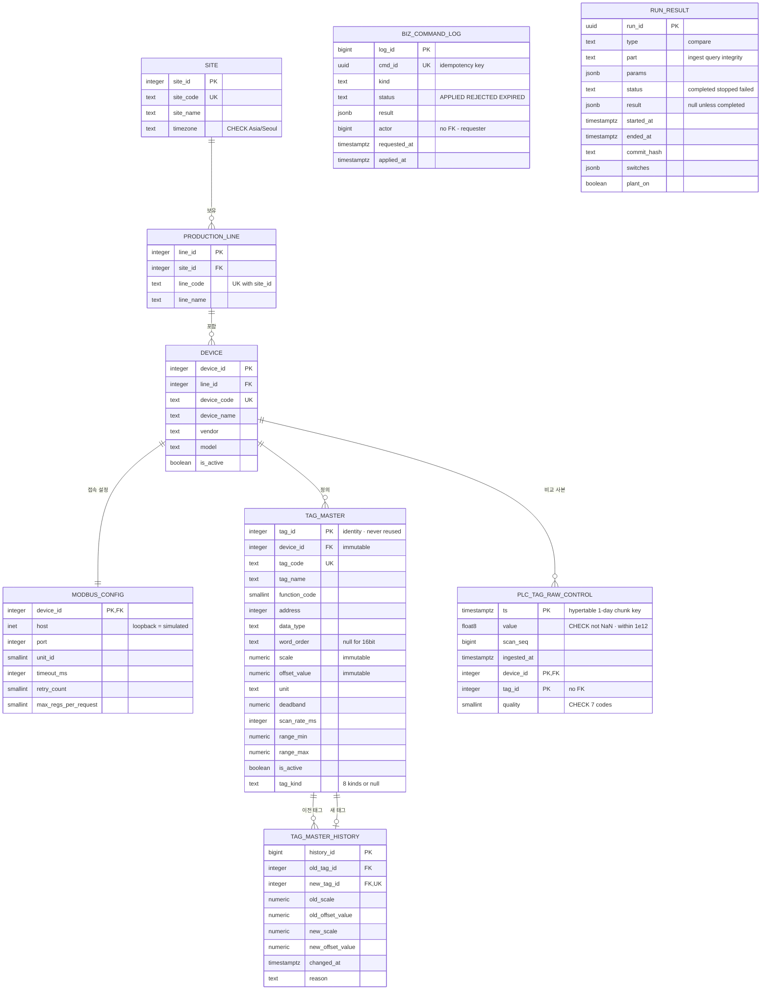
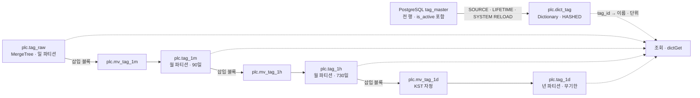
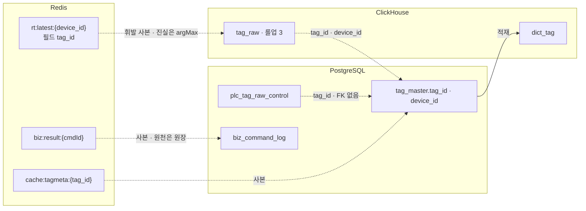

# 전역 ERD (erd)

> **대상**: db_study 저장소 전역의 관계도 — PostgreSQL 업무 7 + 대조군 1 + 실행 보관 1의 erDiagram · ClickHouse 객체 8의 관계 · 저장소를 넘는 논리 참조
> **작성일**: 2026-09-24
> **개정일**: 2026-10-12 — **D-05 부분 개정 · ADR-32**(직접 비교 비교 사본 TimescaleDB hypertable · 열 압축 · 마이그레이션 009) — PLC_TAG_RAW_CONTROL ts 주석 daily partition key → **hypertable 1-day chunk key** · 비교 사본 불릿에 009가 표를 다시 만들어도 키 · 참조 그대로 · 엔터티 셈에서 칸 · 압축 표 제외 — 엔터티 · 관계 수 불변
> **개정일**: 2026-10-11 — **D-16 비교 사본 규칙 · 태그 종류 · 실행 보관**(마이그레이션 006 · 007 · 008) — PostgreSQL ERD에 **DEVICE → PLC_TAG_RAW_CONTROL 관계**(FK device_id · 기본 키 3컬럼) · TAG_MASTER tag_kind · **RUN_RESULT 엔터티**(선 없음) — 관계 6 → **7** · 엔터티 8 → **9** · 저장소를 넘는 참조 CTL 선 표기(tag_id만 FK 없음)
> **개정일**: 2026-10-11 — **D-16 알람 · 로그인 · 권한 · 감사 · 작업지시 · 측정 도구 삭제**(사용자 결정 2026-10-11 · 리드 판정 — WRK 함께 폐지) — PostgreSQL 엔터티 16 → **8**(ALARM_RULE · ALARM_EVENT · USER_ACCOUNT · ROLE · USER_ROLE · WORK_ORDER · PRODUCTION_LOG · AUDIT_LOG 삭제 · TAG_MASTER_HISTORY changed_by 삭제) · 관계(FK) 15 → **6** · ClickHouse 객체 12 → **8**(alarm_eval · 업무 대조 3 삭제) · 논리 참조 9 → **6** · alarm_event PK · USER_ACCOUNT NULL · 알람 사본 불릿 삭제 · BIZ_COMMAND_LOG actor 불릿 교정 · 연쇄 입구 불릿 신설
> **개정일**: 2026-09-28 — 웨이브 1 검수 반영(B-H4 — actor ⓐ 채택) — BIZ_COMMAND_LOG에 **actor**(bigint · FK 없음 — 요청자) 속성 · 선 없음 불릿의 "행위자는 audit_log가 갖는다" → **actor도 선 없음 · 감사 행위자 정본은 audit_log.user_id** — 엔터티 · 관계 수 불변
> **개정일**: 2026-09-28 — 업무 쓰기 Redis 경유 개정(사용자 결정 2026-09-27) — PostgreSQL ERD에 **BIZ_COMMAND_LOG**(선 없음 — FK를 두지 않는 설계) · 엔터티 15 → **16** · 저장소를 넘는 논리 참조에 biz:result → biz_command_log(사본 · 원천은 원장) — 8 → **9** · 관계(FK) 수 불변
> **개정일**: 2026-09-26 — 목적 적합성 실증 W1 — ClickHouse 객체 관계 그림에 업무 대조 테이블 3(계측물 · 선 없음 — 대조군 PLC_TAG_RAW_CONTROL과 같은 처리) — 객체 9 → **12** · 저장소를 넘는 논리 참조는 불변(앱이 읽지 않는 계측물)
> **원천**: ADR-32 · 마이그레이션 009 · 원본 architecture.md §6 · §7.1 · §7.2 · §7.3 · §7.4 · §8.1 · §12(커밋 ff66a37) · docs_plan.md 보정 #15(tag_master_history) · [01_postgresql_schema.md](./01_postgresql_schema.md) · [02_postgresql_constraints.md](./02_postgresql_constraints.md) · [03_clickhouse_schema.md](./03_clickhouse_schema.md) · [04_clickhouse_rollup.md](./04_clickhouse_rollup.md) · [07_cross_store_consistency.md](./07_cross_store_consistency.md) · [10_olap_vs_rdb_control.md](./10_olap_vs_rdb_control.md)

이 문서는 **그림의 자리**다. 컬럼 · 타입 · 제약의 정본은 [01_postgresql_schema.md](./01_postgresql_schema.md) · [02_postgresql_constraints.md](./02_postgresql_constraints.md) · [03_clickhouse_schema.md](./03_clickhouse_schema.md) · [04_clickhouse_rollup.md](./04_clickhouse_rollup.md)가 갖고, 이 문서는 관계만 그린다. 그림과 정본이 어긋나면 정본이 이긴다.

다이어그램 예산의 예외 문서다([../CLAUDE.md](../CLAUDE.md)) — mermaid를 셋 둔다. PostgreSQL은 FK가 있는 관계형이라 erDiagram으로, ClickHouse는 FK가 없고 삽입 연쇄 · 사전 적재가 관계라 flowchart로, 저장소를 넘는 참조는 FK로 표현할 수 없어 flowchart로 그린다.

## 표기 규약

| 표기 | 뜻 |
|------|------|
| 엔터티 이름 대문자 | PostgreSQL 테이블 — 실제 이름은 소문자 snake_case |
| PK · FK · UK | 기본 키 · 외래 키 · 유일 제약 |
| 속성 옆 따옴표 | 컬럼 제약 · 뜻의 요약 |
| \|\|--o{ | 하나 대 여럿(필수 → 선택) |
| \|o--o{ | 선택적 하나 대 여럿 — 참조 컬럼이 NULL 허용 |
| \|\|--\|\| | 하나 대 하나 |
| \|\|--o\| | 하나 대 선택적 하나 |
| 실선 화살표(flowchart) | 삽입이 발동하는 연쇄 · 적재 |
| 점선 화살표(flowchart) | 조회 시점 참조 · FK 없는 논리 참조 |

- 검산: 표기 = **9**

## PostgreSQL ERD

업무 7 테이블 · 대조군(비교 사본) 1 · 실행 보관 1이다. 비교 사본은 D-16(007)부터 설비를 참조한다 · biz_command_log와 run_result는 관계가 없다 — FK를 두지 않는 것이 설계다([10_olap_vs_rdb_control.md](./10_olap_vs_rdb_control.md) · [02_postgresql_constraints.md](./02_postgresql_constraints.md) §FK 전수).

- **tag_master_history는 tag_master를 두 번 가리킨다.** 이전 태그(여럿이 될 수 있다 — 한 태그의 스케일을 여러 번 바꾸면 매번 새 태그가 이전 태그가 된다)와 새 태그(UNIQUE — 한 새 태그의 계보는 한 행)다.
- **BIZ_COMMAND_LOG에 선이 없는 것은 누락이 아니다.** 명령이 가리키는 업무 행은 kind마다 테이블이 달라 한 FK로 표현되지 않고, **actor(요청자)는 선이 없다** — 로그인이 없어 늘 NULL이고 가리킬 계정 테이블도 없다(D-16) — 원장은 cmd_id UNIQUE 하나로 멱등만 강제한다([01_postgresql_schema.md](./01_postgresql_schema.md) §biz_command_log 설계).
- **PLC_TAG_RAW_CONTROL은 설비만 참조하고 태그는 참조하지 않는다(D-16 · 007).** 설비 참조는 무결성 시험(등록 안 된 설비)의 근거이고, 태그에 선이 없는 것은 시험 태그 대역 · 태그 계보 때문이다 — 옛 대조군은 tag_raw와 동형인 계측물이라 선이 하나도 없었다([10_olap_vs_rdb_control.md](./10_olap_vs_rdb_control.md) §지금 모양 — 직접 비교(D-16)). 009가 표를 TimescaleDB hypertable로 다시 만들었어도 컬럼 · 키 · 설비 참조는 007 그대로다(ADR-32) — 그림이 바뀌지 않는다.
- **RUN_RESULT에 선이 없는 것은 누락이 아니다.** 직접 비교의 종결 결과 보관이라 가리키는 업무 행이 없다 — 실행 ID는 api가 발급한 runId다([01_postgresql_schema.md](./01_postgresql_schema.md) §run_result 설계).

### 관계 검산

| 관계 | FK 컬럼 | 카디널리티 | 소유 도메인 |
|------|------|------|------|
| 보유 · 포함 · 접속 설정 · 정의 | production_line.site_id · device.line_id · modbus_config.device_id · tag_master.device_id | 1:N · 1:N · 1:1 · 1:N | MST |
| 이전 태그 · 새 태그 | tag_master_history.old_tag_id · new_tag_id | 1:N · 1:0..1 | MST |
| 비교 사본 | plc_tag_raw_control.device_id | 1:N | ING(참조되는 쪽 MST) |

- 검산: 관계 = 4 + 2 + 1 = **7** = FK 전수([02_postgresql_constraints.md](./02_postgresql_constraints.md))
- 엔터티 = 업무 7(MST 6 + biz_command_log) + 대조군 1 + 실행 보관 1(run_result) = **9** — 루트 고정 기준과 같다(비교 사본 hypertable의 칸 · 압축 표는 TimescaleDB 내부 표라 엔터티로 세지 않는다) · 옛 changed_by · ALM 3 · AUT 2 · WRK 3 관계와 AUT 3 · ALM 2 · WRK 3 · 감사 엔터티는 D-16 삭제

## ClickHouse 객체 관계

ClickHouse에는 FK가 없다. 객체 사이의 관계는 **삽입이 발동하는 MV 연쇄**와 **Dictionary의 원천 적재**뿐이다.

- 검산: 객체 = 테이블 4(tag_raw · tag_1m · tag_1h · tag_1d) + MV 3 + Dictionary 1 = **8** — 루트 고정 기준과 같다
- **연쇄의 입구는 tag_raw 하나다.** 롤업 테이블에 직접 쓰면 붙어 있는 상위 MV가 그대로 발동해 위 롤업까지 채운다 — 백필이 mv_tag_1m 하나만 분리하는 이유다([04_clickhouse_rollup.md](./04_clickhouse_rollup.md) §백필 절차).
- **옛 alarm_eval · 업무 대조 테이블 3은 D-16으로 지웠다.** 쓰던 주체(알람 판정 경로 · 역방향 실행기)가 함께 사라졌다 — 객체 12 → 8.
- **Dictionary는 행을 잇지 않는다.** dictGet은 조회 시점에 tag_id를 해석으로 바꿀 뿐이며, 시계열 행은 이름을 갖지 않는다(ADR-16).

## 저장소를 넘는 논리 참조

세 저장소의 키가 서로를 가리키는 자리다. 어느 선도 FK가 아니며, 끊어지는 조건과 드러나는 자리는 [07_cross_store_consistency.md](./07_cross_store_consistency.md) §교차 저장소 참조 전수가 정본이다.

- **점선은 전부 FK 없는 참조다.** 시계열 · 대조군 → PostgreSQL 마스터 2(RAW · CTL) + Redis → 원천 3(RTL · TMC · BRS). 실선 하나(tag_master → dict_tag)는 주기 적재다.
- 검산: 논리 참조 = 점선 2 + 3 = 5 + 적재 실선 1 = **6** · 옛 알람 참조 3(AE · AEV · AST)은 D-16 삭제
- **Redis 키 전수는 이 그림에 없다.** 저장소를 넘는 참조를 가진 키만 그렸다 — 키 패턴 전수와 봉인 표의 정본은 [05_redis_keyspace.md](./05_redis_keyspace.md)다.

## 관련 문서

- [01_postgresql_schema.md](./01_postgresql_schema.md) — PostgreSQL 컬럼 정본
- [02_postgresql_constraints.md](./02_postgresql_constraints.md) — FK · 제약 · 한계 등재
- [03_clickhouse_schema.md](./03_clickhouse_schema.md) — ClickHouse 객체 목록 · DDL
- [04_clickhouse_rollup.md](./04_clickhouse_rollup.md) — MV 연쇄
- [05_redis_keyspace.md](./05_redis_keyspace.md) — Redis 키 패턴 정본
- [07_cross_store_consistency.md](./07_cross_store_consistency.md) — 교차 저장소 참조 · 진실의 자리
- [10_olap_vs_rdb_control.md](./10_olap_vs_rdb_control.md) — 대조군 명세
